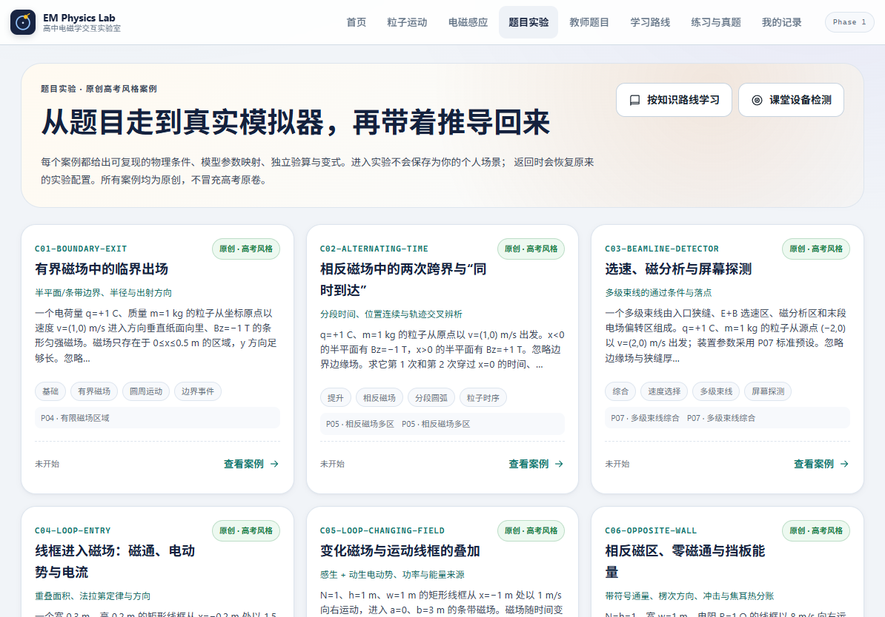

# EM Physics Lab｜高中电磁学交互实验室

平板优先的高中 / 高考物理电磁学交互学习 PWA。用真实解析求解器把带电粒子、磁场、线框、导体棒和整道综合题变成可触摸、可播放、可核验的实验。

**在线体验：<https://soft-toffee-cbd208.netlify.app/>**



## 主要功能

- **16 个交互模型**：P01–P08（洛伦兹力、匀速圆周、半平面/有限/多区磁场、复合场、多级束线、约束反求）与 I01–I08（磁通/楞次、单棒、线框进出、时变场、运动线框、双棒、反向场+挡板、交流发电机）。
- **真实物理**：解析解或经过验证的数值求解器、真实边界/碰撞/屏幕事件、统一仿真时间；不改用预制轨迹。
- **实时操作**：触控调参、1–5 粒子独立初态、播放中单粒子编辑、手动拖动/调参历史、教师图层、速度与能量图表。
- **安全数学输入**：滑动条旁直接输入 `√3/2`、`1/3`、`π`、`2π` 等表达式；物理上合法的超滑块值不会被静默钳制。
- **9 个原创整题案例**：C01–C08 + A17-01，同一舞台连续演示，逐问推导、提示、答案输入、量纲核对与变式；全部为原创教学案例，不冒充高考原题。
- **132 道原创练习**：单选、多选、数值题，分层提示、解析、收藏、错题记录与本地进度。
- **学习路线**：按粒子/电磁场和电磁感应两条路线串联 16 个模型，提供真实讲解、预设实验与配套练习。
- **教师题目工作台**：本机创建、编辑、复制、预览、导入/导出复杂题；支持 A17-01/A17-02 模板与逐问答案绑定。
- **完整本地备份**：在“我的记录”导出/恢复模型场景、练习题进度、案例进度、教师草稿与设备自测记录。

## 使用方式

1. 浏览器打开在线地址，选择“粒子运动 / 电磁感应 / 题目实验 / 学习路线 / 练习与真题”。
2. 拖动或输入参数，播放/暂停/逐事件回放；切换讲解、数据、教师视图。
3. 在题目实验中先预测，再启动真实仿真，返回后展开逐问推导并输入答案。
4. iPad Safari 用“分享 → 添加到主屏幕”；Android Chrome 用菜单“安装应用 / 添加到主屏幕”。桌面浏览器可直接使用。
5. 首次联网完整加载后，已缓存页面可离线打开；未联网首次安装不能凭空获得离线内容。

正式站点已上线，iPad Safari 已可打开并添加到主屏幕。完整课堂设备矩阵（Android、软键盘、读屏、WebGL 恢复、长时间发热/续航）仍需按 [设备验收](docs/DEVICE_ACCEPTANCE.md) 持续记录，不能以桌面模拟代替真机结论。

## 数据与内容说明

- 学习记录、教师草稿、案例进度和设备自测都保存在**当前浏览器本地**；没有账号、云同步或自动上传。
- 清除站点数据、换浏览器/设备、换域名或使用不同 WebView 都不会自动保留数据；迁移前请使用“我的记录 → 完整本地数据备份”导出/导入。
- 教师题包可能包含私有题目，请勿公开发送；教师入口是本地工作台，不是服务端认证后台。
- 内置练习与整题案例为原创教学材料；5 条高考来源仅保留未核验的元数据/外链，不复制题干、图片或第三方答案。
- 仿真为教学理想模型，忽略边缘场、自感、摩擦、相对论等超出模型边界的效果。

## 开源许可

本项目源代码、原创练习题、原创整题案例与原创教学文字采用 **GNU General Public License v3.0 only**（SPDX：`GPL-3.0-only`）。

Copyright (C) 2026 EM Physics Lab contributors。

你可以按 GPLv3 使用、研究、修改、再分发，包括商业用途；分发修改版或衍生作品时须遵守 GPLv3，保留版权/许可声明并提供对应源代码。完整条款见 [LICENSE](LICENSE)。

第三方依赖、字体、工具和外部真题来源保留各自许可/权利，项目 GPL 不覆盖第三方版权；详见 [第三方许可审计](docs/THIRD_PARTY_LICENSES.md) 与 [NOTICE](NOTICE)。

## 本地开发

```bash
npm ci
npm run dev
npm run typecheck && npx vitest run
npm run build && npx playwright test && npm run test:pwa && npm run verify:static
```

维护、发布、回滚、数据迁移和验收流程见 [docs/MAINTENANCE.md](docs/MAINTENANCE.md)。提交通过 `codex/<task>` 分支 → PR → CI → 维护者合并 `main`；不要直接向生产 `main` 推送或强制推送。
